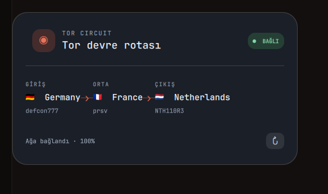

# Tor Circuit

A small desktop card for Wayland (Quickshell) that shows the relays of your
running Tor circuit: **entry (guard) → middle → exit**, with country flags,
country names and relay nicknames.

It talks to the local Tor control port only, resolves countries through Tor's
own GeoIP database (`ip-to-country`), sends nothing to any third-party service
and never changes your circuit.



## Requirements

- Quickshell (`qs`), Python 3
- `python-stem`, `python-pycountry`
- Tor with a local control port (see below)

## Install

```sh
./install.sh
```

This copies the widget to `~/.config/quickshell/tor-circuit/` and enables the
`tor-circuit-widget.service` user service, so the card returns with every
login.

Drag the card by its header to move it. The position is stored in
`~/.config/quickshell/tor-circuit/position.json` and is clamped to the screen.
`↻` refreshes immediately; otherwise the card refreshes every 10 seconds.

## Show / hide

| What | How |
| --- | --- |
| Terminal | `tor-widget toggle`, `start`, `stop`, `status` |
| systemd | `systemctl --user start\|stop tor-circuit-widget` |
| Compositor | bind `tor-widget toggle` to a key |

For example, in Hyprland's config:

```conf
bind = SUPER SHIFT, T, exec, tor-widget toggle
```

If the card ends up off-screen, reset its position:

```sh
printf '{"x":300,"y":300}' > ~/.config/quickshell/tor-circuit/position.json
tor-widget stop; tor-widget start
```

## Tor control port (one time)

The widget reads the circuit over Tor's control port. `/etc/tor/torrc` needs:

```text
ControlPort 127.0.0.1:9051
CookieAuthentication 1
```

Tor recreates its control cookie at every start, so the read permission has to
be re-applied each time:

```sh
sudo ./setup-tor-access.sh
```

The script installs a tiny `tor-control-acl.service` helper. It runs after Tor
is ready, grants only your user read access to the cookie (ACL), and restarts
with Tor. The port stays bound to `127.0.0.1` and still requires the cookie.

> Why a separate unit: `tor.service` runs in a hardened sandbox without
> `CAP_FOWNER`, so running `setfacl` inside it fails with "Operation not
> permitted" and takes the whole Tor service down. The ACL step therefore runs
> outside that sandbox.

## Files

| File | Purpose |
| --- | --- |
| `shell.qml` | The card itself (Quickshell layer surface, drag, polling) |
| `tor_status.py` | Reads the circuit and countries from the control port, prints JSON |
| `install.sh` | Per-user install and service |
| `tor-widget` | Start/stop/toggle helper (`~/.local/bin/tor-widget`) |
| `setup-tor-access.sh` | Cookie read permission (sudo, once) |

## Notes

- Country codes are approximate locations of relay IPs; the entry country does
  not have to be your own.
- Without a built circuit the card shows "TOR BEKLENİYOR" and the reason on the
  bottom line.
- Service status: `systemctl --user status tor-circuit-widget`

## License

MIT
